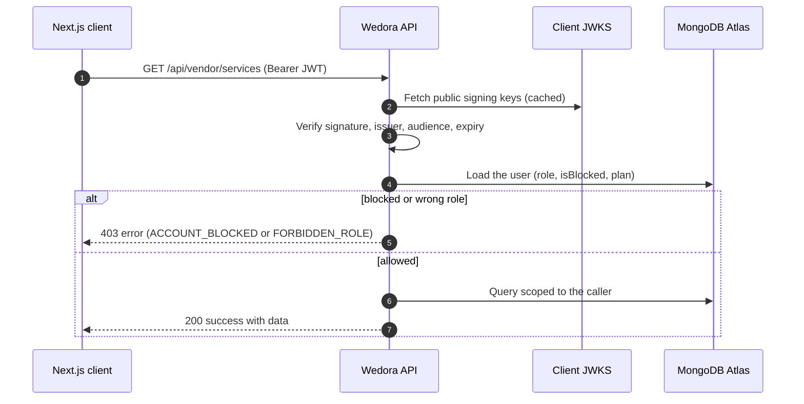

<div align="center">

# Wedora API

**REST API for Wedora, a wedding services marketplace.**

Wedding services, booking requests, admin moderation and Stripe subscriptions. Every rule is enforced on the server.

**[Health check](https://wedora-planner-server.vercel.app/api/health)** · **[Live website](https://wedora-planner.vercel.app)** · **[Client repository](https://github.com/shariardipto/Wedora-Client)**


</div>

## Contents

- [Overview](#overview)
- [Highlights](#highlights)
- [Tech stack](#tech-stack)
- [Architecture](#architecture)
- [Security model](#security-model)
- [API reference](#api-reference)
- [Business rules](#business-rules)
- [Payments with Stripe](#payments-with-stripe)
- [Data model](#data-model)
- [Project structure](#project-structure)
- [Getting started](#getting-started)
- [Environment variables](#environment-variables)
- [Scripts](#scripts)
- [Testing](#testing)
- [Deployment](#deployment)

## Overview

This repository is the **backend** of Wedora. It's an Express 5 API written in TypeScript that owns all business data:

- wedding services and their review workflow
- booking requests between couples and vendors
- dashboard statistics
- user moderation
- vendor subscriptions billed through Stripe

The **[Wedora client](https://github.com/shariardipto/Wedora-Client)** (Next.js 16) signs users in with Better Auth and calls this API with short-lived JWTs.

| | |
| --- | --- |
| Base URL | <https://wedora-planner-server.vercel.app> |
| Health check | [`GET /api/health`](https://wedora-planner-server.vercel.app/api/health) |
| Website | <https://wedora-planner.vercel.app> |

## Highlights

- **Server is the authority.** A JWT only proves identity. Role, block status and plan are loaded from MongoDB on every request, so an admin's block takes effect immediately.
- **Ownership in every query.** Vendor, customer and admin operations are scoped by the caller's id from the token; IDs from the client are never trusted.
- **Race-safe state changes:**
  - Booking decisions use atomic `findOneAndUpdate` on `status: "pending"`.
  - A partial unique index blocks duplicate bookings, even when requests arrive at the same time.
- **Premium only through a verified webhook.** Stripe signatures are checked on the raw body. Handling is idempotent and safe for events that arrive out of order.
- **Strict input handling:**
  - Every body and query is validated with Zod, and unknown fields are rejected.
  - JSON bodies are capped at 100 KB.
  - Malformed ids return `404`.
- **Consistent responses:** one JSON envelope with machine-readable error codes.

## Tech stack

| Area | Technology |
| --- | --- |
| Runtime | Node.js 24, TypeScript (ESM, strict) |
| Framework | Express 5 |
| Database | MongoDB Atlas, using the native `mongodb` driver |
| Authentication | JWT verification with `jose` against the client's Better Auth JWKS (EdDSA) |
| Validation | Zod |
| Payments | Stripe (Checkout in subscription mode, webhooks) |
| Security | Helmet, strict single-origin CORS |
| Testing | Vitest, Supertest |
| Hosting | Vercel serverless functions (`sin1` region) |

## Architecture



The API runs as one Express app. [`src/create-app.ts`](src/create-app.ts) wires the middleware and routes, and [`src/index.ts`](src/index.ts) exports it for Vercel or listens on a port locally. Routes are thin. Business logic lives in `src/services`, and request schemas in `src/validators`.

## Security model

- **Tokens:**
  - The client issues EdDSA JWTs that expire after 15 minutes.
  - Protected routes require `Authorization: Bearer <jwt>`.
  - The API checks the signature, `iss`, `aud` and `exp` against the client's JWKS. The keys are cached, with a 10 s fetch timeout.
- **401 vs 403:**
  - A missing, invalid or expired token returns **401** (`AUTH_REQUIRED`, `INVALID_TOKEN`).
  - A blocked user (`ACCOUNT_BLOCKED`) or the wrong role (`FORBIDDEN_ROLE`) returns **403**.
  - New Google users must choose a role first (`ROLE_REQUIRED`).
- **Roles:** `requireRole("customer" | "vendor" | "admin")` guards each route group. Admin accounts come only from a seed script; nobody can sign up as admin.
- **Protected fields:** role, block status and subscription fields can never be written by users. Admins can't block themselves or other admins.
- **Transport:** CORS allows only `CLIENT_ORIGIN`, and Helmet sets the security headers. The Stripe webhook is mounted before the JSON parser so its raw body can be verified.
- **Secrets:** read from environment variables only. Configuration errors name the variable, never its value.

## API reference

All endpoints are under `/api` and use JSON. Protected endpoints need `Authorization: Bearer <jwt>`.

**Response format**

```json
{ "success": true, "data": { } }
```

```json
{ "success": false, "message": "A readable explanation", "error": { "code": "MACHINE_CODE" } }
```

**Status codes**

| Code | Meaning |
| --- | --- |
| `200` / `201` | Success / created |
| `400` | Validation failed (`VALIDATION_ERROR`) or bad JSON |
| `401` | Not signed in or invalid token |
| `403` | Blocked, wrong role, or plan limit reached (`PLAN_LIMIT_REACHED`) |
| `404` | Not found or not yours (malformed ids too) |
| `409` | Conflict: duplicate booking, request already processed, already Premium |
| `503` | A dependency is temporarily unavailable |

### Public

| Method | Path | Description |
| --- | --- | --- |
| `GET` | `/api/health` | Liveness check |
| `GET` | `/api/services` | Approved, available services. Query: `q`, `category`, `location`, `minPrice`, `maxPrice`, `sort` (`newest`, `price_asc`, `price_desc`), `page`, `limit` |
| `GET` | `/api/services/featured` | Newest approved services for the home page |
| `GET` | `/api/services/categories` | Number of live services per category |

### Account

| Method | Path | Access | Description |
| --- | --- | --- | --- |
| `GET` | `/api/me` | signed in | Current profile, read fresh from the database |
| `POST` | `/api/me/role` | signed in, no role yet | One-time Customer/Vendor choice for Google sign-ups (`409` if already set) |
| `GET` | `/api/services/:id` | signed in | Service details. Customers see public services only; the owning vendor and admins see any status |

### Vendor

| Method | Path | Description |
| --- | --- | --- |
| `GET` | `/api/vendor/services` | Own services plus plan usage (`activeCount`, `activeLimit`) |
| `POST` | `/api/vendor/services` | Create a service; it starts as **pending** review |
| `PATCH` | `/api/vendor/services/:id` | Update. Content changes send approved or rejected services back to review |
| `PATCH` | `/api/vendor/services/:id/availability` | Pause or resume |
| `DELETE` | `/api/vendor/services/:id` | Delete; also cancels pending booking requests |
| `GET` | `/api/vendor/bookings` | Requests for own services, with customer contact details (`status` filter) |
| `PATCH` | `/api/vendor/bookings/:id` | `{ "status": "accepted" \| "rejected" }`, pending requests only, once |
| `GET` | `/api/vendor/stats` | Service, booking and plan statistics |

### Customer

| Method | Path | Description |
| --- | --- | --- |
| `POST` | `/api/bookings` | Request a booking: `serviceId`, `eventDate` (`YYYY-MM-DD`), `eventLocation`, `message` |
| `GET` | `/api/customer/bookings` | Own booking requests with service and vendor info (`status` filter) |
| `GET` | `/api/customer/bookings/:id` | Booking details |
| `PATCH` | `/api/customer/bookings/:id/cancel` | Cancel a pending request |
| `GET` | `/api/customer/stats` | Booking counts by status |

### Admin

| Method | Path | Description |
| --- | --- | --- |
| `GET` | `/api/admin/stats` | Users, vendors, customers, blocked users, services, pending services, transactions |
| `GET` | `/api/admin/services` | All services. Query: `q`, `status`, `category`, `page`, `limit` |
| `PATCH` | `/api/admin/services/:id/status` | Approve, reject (reason required), or send back to review |
| `DELETE` | `/api/admin/services/:id` | Remove an inappropriate service |
| `GET` | `/api/admin/users` | Users. Query: `q` (name, email, business), `role`, `status`, `page`, `limit` |
| `GET` | `/api/admin/users/:id` | User details with activity counts |
| `PATCH` | `/api/admin/users/:id/block` | `{ "isBlocked": true \| false }`; blocking deletes the user's sessions |
| `GET` | `/api/admin/transactions` | Read-only payment ledger with vendor info, search, status filter, pagination and totals |

### Billing

| Method | Path | Access | Description |
| --- | --- | --- | --- |
| `POST` | `/api/billing/checkout` | vendor | Start Stripe Checkout for Premium and return `{ url }`. An open session is reused; `409` if already Premium |
| `GET` | `/api/billing/status` | vendor | Plan, paid-through date, cancellation flag, recent payments. `?session_id=` adds that checkout's status (own sessions only) |
| `POST` | `/api/billing/cancel` | vendor | Cancel at period end; Premium stays until the paid-through date |
| `POST` | `/api/billing/resume` | vendor | Undo a scheduled cancellation |
| `POST` | `/api/webhooks/stripe` | Stripe signature | The **only** way Premium is activated |

## Business rules

| Rule | Behaviour |
| --- | --- |
| Sign-up roles | Email sign-up accepts only `customer` or `vendor`. Admins come only from the seed script |
| Public visibility | Listings and bookings require `status = approved` and `isAvailable = true` |
| Free plan limit | At most **3 active services** (pending or approved, and available). Premium is unlimited |
| Re-review | Editing an approved or rejected service's content sends it back to `pending`. Pausing or resuming doesn't |
| Booking requests | Customers only. The event date runs from tomorrow up to 2 years ahead, and no one can book their own service |
| Duplicates | One active (pending or accepted) request per customer, service and date. Enforced by a partial unique index |
| Vendor decisions | Accept or reject a pending request exactly once; later attempts return `409` |
| Cancellation | Customers can cancel only pending requests |
| Service deletion | Pending requests are cancelled; accepted bookings keep their record |
| Moderation | Blocking signs the user out everywhere and blocks every protected endpoint |

## Payments with Stripe

1. A vendor calls `POST /api/billing/checkout`. The server sets the price (**$29/month in USD**, with local-currency conversion off), attaches the vendor id from the token, and records a `pending` transaction.
2. The vendor pays on the Stripe-hosted Checkout page.
3. Stripe sends signed webhooks. The handler verifies the signature on the raw body, re-reads the subscription from Stripe, and updates the plan and the transaction. Redeliveries are harmless because session and invoice ids are unique.

| Event | Effect |
| --- | --- |
| `checkout.session.completed`, `checkout.session.async_payment_succeeded` | Premium on; transaction `paid` |
| `checkout.session.expired`, `checkout.session.async_payment_failed` | Transaction `expired` / `failed` |
| `invoice.paid`, `invoice.payment_failed` | Renewal recorded; paid-through date extended |
| `customer.subscription.created`, `.updated`, `.deleted` | Plan, expiry and cancellation kept in sync; deletion returns the vendor to Free |

If handling fails, the endpoint returns `5xx` and Stripe retries.

**Local testing** with the [Stripe CLI](https://docs.stripe.com/stripe-cli):

```bash
stripe listen --forward-to localhost:5000/api/webhooks/stripe \
  --events checkout.session.completed,checkout.session.async_payment_succeeded,checkout.session.async_payment_failed,checkout.session.expired,invoice.paid,invoice.payment_failed,customer.subscription.created,customer.subscription.updated,customer.subscription.deleted
```

Put the printed `whsec_…` secret in `STRIPE_WEBHOOK_SECRET`. Test card: `4242 4242 4242 4242`, any future date, any CVC.

## Data model

Better Auth (in the client) owns the `user`, `session`, `account`, `verification` and `jwks` collections. This API reads `user` and adds the business collections.

| Collection | Key fields |
| --- | --- |
| `user` | `role` (`customer` \| `vendor` \| `admin` \| `null`), `isBlocked`, `businessName`, `phone`, `subscriptionPlan` (`free` \| `premium`), `subscriptionExpiresAt`, Stripe customer/subscription ids |
| `services` | `vendorId`, `serviceName`, `category` (one of 6), `description`, `price` (whole USD), `location`, `images` (1–5 ImgBB URLs), `status` (`pending` \| `approved` \| `rejected`), `isAvailable`, `rejectionReason` |
| `bookings` | `serviceId`, `vendorId` (copied from the service), `customerId`, `eventDate`, `eventLocation`, `message`, `status` (`pending` \| `accepted` \| `rejected` \| `cancelled`) |
| `transactions` | `vendorId`, `kind` (`subscription` \| `renewal`), `amount` (cents), `currency`, Stripe session/subscription/invoice ids, `status` (`pending` \| `paid` \| `failed` \| `expired`), `paidAt` |

`npm run db:setup` creates the indexes:
- compound indexes for browsing and dashboards
- a text index for search
- the partial unique indexes behind duplicate-booking and webhook idempotency

## Project structure

```text
src/
├── index.ts            # Entry point: exports the app for Vercel, listens locally
├── create-app.ts       # Middleware and route wiring (Helmet, CORS, webhook, JSON, routes)
├── config/             # Environment parsing (Zod) and the MongoDB connection
├── middleware/         # Authentication, role guards, error handling
├── routes/             # Thin HTTP layer, one file per resource
├── services/           # Business logic and database access
├── validators/         # Zod request schemas
├── lib/                # JWT verification, Stripe gateway, API errors, ObjectId helpers
├── types/              # Domain types
└── scripts/            # setup-database.ts (indexes)
tests/                  # Vitest + Supertest suites with in-memory fakes
```

## Getting started

### Prerequisites

- Node.js **24** and npm
- A MongoDB Atlas cluster (MongoDB 6.0 or newer), shared with the client
- The [Wedora client](https://github.com/shariardipto/Wedora-Client) running locally, because it issues the JWTs
- A Stripe account in test mode, plus the Stripe CLI for local webhooks

### Setup

```bash
git clone https://github.com/shariardipto/Wedora-Server.git
cd Wedora-Server
npm ci
cp .env.example .env     # fill in the values (see below)
npm run db:setup         # create indexes (safe to re-run)
npm run dev              # http://localhost:5000
```

> If your shell sets `NODE_ENV=production`, install with `npm ci --include=dev`.

Check that it's running: <http://localhost:5000/api/health>.

## Environment variables

Copy [`.env.example`](.env.example) to `.env`.

| Variable | Required | Description |
| --- | :---: | --- |
| `NODE_ENV` | | `development` (default), `test` or `production` |
| `PORT` | | Local port (default `5000`) |
| `CLIENT_ORIGIN` | ✓ in production | Exact client origin for CORS, no trailing slash |
| `MONGODB_URI` | ✓ | MongoDB connection string |
| `MONGODB_DB_NAME` | | Database name (default `wedora`) |
| `BETTER_AUTH_JWKS_URL` | ✓ | The client's JWKS endpoint, e.g. `http://localhost:3000/api/auth/jwks` |
| `BETTER_AUTH_ISSUER` | ✓ | Expected JWT issuer (the client URL) |
| `BETTER_AUTH_AUDIENCE` | ✓ | Expected JWT audience (the client URL) |
| `STRIPE_SECRET_KEY` | ✓ for payments | Stripe secret key (test mode) |
| `STRIPE_WEBHOOK_SECRET` | ✓ for payments | Signing secret of the webhook endpoint or the Stripe CLI |

Without the Stripe variables, billing endpoints return `503 PAYMENTS_UNAVAILABLE`; everything else keeps working.

## Scripts

| Command | Description |
| --- | --- |
| `npm run dev` | Start the API with hot reload (`tsx watch`) |
| `npm run build` | Compile TypeScript to `dist/` |
| `npm start` | Run the compiled build |
| `npm run lint` | Run ESLint (fails on any warning) |
| `npm run typecheck` | Type-check without emitting |
| `npm test` | Run the test suite |
| `npm run db:setup` | Create MongoDB indexes (idempotent) |

## Testing

**129 tests across 10 suites** (Vitest + Supertest). They run against the real Express app, with in-memory fakes for the database and the Stripe gateway. They cover:

- **Auth:** missing, forged, tampered and expired tokens; 401 vs 403; blocked users; role guards; the one-time role choice
- **Services:** validation, public visibility, the Free-plan limit, re-review on edit, ownership, admin moderation
- **Bookings:** creation rules, duplicates, vendor decisions, customer cancellation, cascade on service deletion
- **Admin and statistics:** user search and filters, block and unblock rules, dashboard counts
- **Billing:** checkout rules, session reuse, cancel and resume, webhook signatures, idempotency, out-of-order events, renewals and downgrades
- **Configuration:** environment parsing that never leaks values

```bash
npm test
```

## Deployment

The API is deployed on **Vercel** as a zero-config Express app.

1. Import the repository. Vercel detects `src/index.ts`, which default-exports the Express app. Don't add other root or `src/` files named `app`, `index` or `server`.
2. [`vercel.json`](vercel.json) pins the function region to `sin1` (Singapore), next to the MongoDB Atlas cluster.
3. Set the environment variables above in **Project → Settings → Environment Variables**:
   - `CLIENT_ORIGIN`, `BETTER_AUTH_ISSUER` and `BETTER_AUTH_AUDIENCE`: the client's production URL.
   - `BETTER_AUTH_JWKS_URL`: `https://<client-domain>/api/auth/jwks`.
   - `NODEJS_HELPERS=0`: Vercel's request helpers must not pre-parse the body, because the Stripe webhook needs the raw bytes.
4. In **MongoDB Atlas → Network Access**, allow connections from Vercel. Its functions use dynamic IPs.
5. In **Stripe → Developers → Webhooks**:
   - Add the endpoint `https://<api-domain>/api/webhooks/stripe` for the nine events listed above.
   - Set its signing secret as `STRIPE_WEBHOOK_SECRET`.
